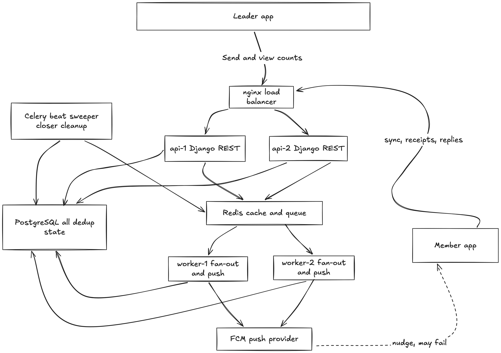

## 01 The Ask

### Requirements
**Restate what you're actually going to build, in your own words, as if explaining it back to Denise.**

Hi Denise, sorry about Thursday. Here’s what we’ll build. When you send a callout, every member of your local gets it in the app, and it waits there until their phone has signal, so a day underground doesn’t mean missing it. The phone notification is just a nudge on top. You’ll see how many members have received it, opened it, and replied *Coming* or *Can’t make it*. The numbers refresh every few minutes, and you can refresh them yourself right before you leave the hall. Resending a callout will never give anyone a second copy. And nobody outside your local can see your members’ contact info, apprentices included. We’ll confirm that isn’t happening today either.

### Assumptions
**List your assumptions for everything the message doesn't specify:**
* **Scope:** Leaders send callouts and see results for their own local only. Each member belongs to one local for now.
* **Idempotency:** A callout goes to every member of that local exactly once. A retry or a restart never creates a second copy.
* **Delivery:** “Delivered” means the member’s app actually has the callout, not just that we pushed it.
* **Responses:** Replying is requested, not required. The dashboard shows *Coming*, *Can’t make it*, and *No response*, and the three add up to the total.
* **Dashboard:** The dashboard shows counts only, refreshed on a timer or by the leader.
* **Completion:** A callout is done at the meeting time. The numbers freeze, and anything that arrives later is marked missed.

### Flags
**Flag anything in the message that concerns you:**
* **Discrepant Numbers:** The numbers don’t add up. Push fails silently 5–10% of the time for about 1,100–2,200 people in our largest local. But half that local is 11,200, so other factors may be involved: members offline, a late callout, or people missing from the list. Delivery records should clarify. 
* **Privacy Leak:** I’d also first check the report that apprentice contact info is visible to other locals. 
* **Timeline:** Contract talks have no date, so I assume they’re soon.

### Questions for Client
1. **When was Thursday’s callout sent, and when was the meeting?** 
   * *Assumption:* It went out too close to the meeting for offline members, so the app will show how much notice each callout gave.
2. **Did anyone actually see apprentice contact info, and should other members of your local see it, too?** 
   * *Assumption:* Only leaders in their own local can see it.
3. **When are the contract talks, and what has to be done by then?** 
   * *Assumption:* It’s soon, so reaching members and the headcount of who’s coming come first.

---

## 02 Part A: The Design

### 1. Data Model

```sql
locals                     -- (unchanged)

members
  id, local_id, user_id    -- (1:1 with the login account)
  full_name, email, classification, status
  index (local_id, status)

leadership_roles
  member_id, local_id, role, granted_by, granted_at, revoked_at
  unique (member_id, local_id)

member_devices
  member_id, push_token, platform, last_seen_at, disabled_at

announcements
  id, local_id, created_by, title, body, needs_ack
  starts_at                -- meeting time, null for plain announcements
  status                   -- draft | sending | sent | closed
  source                   -- manual | ai
  audience_classifications -- text array (e.g. ['Journeyman Wireman', 'Foreman'])
  push_preview             -- short preview text, max 120 chars
  approved_by              -- member_id (nullable), leader who approved
  approved_at              -- timestamp (nullable), cleared on any draft text edit
  recipient_count, final_counts (jsonb), sent_at, created_at
  idempotency_key          -- unique per (local_id, key)

announcement_recipients    -- one row per announcement per member
  id (bigint), announcement_id, member_id, local_id
  delivered_at, read_at, acknowledged_at
  response                 -- null | coming | cant_make_it
  responded_at, push_sent_at, push_error
  unique (announcement_id, member_id)
  index (member_id, id desc)
  fillfactor 80
```

* **Who it went to:** When a send starts, I create one recipient row for every active member of that local. A missing row means the member was never targeted, and a row with every field empty means “nothing happened”. I rejected creating rows lazily when members open the app, because then “nothing” can’t be counted and a restarted push worker has no record of who was already pushed.
* **What each member did:** Each action has its own timestamp, empty until it happens and set only once (`COALESCE`), so a late or repeated event from an offline phone can’t undo anything. Delivered means the app confirmed it stored the callout. A reply also sets read and acknowledged. I rejected a single status column, because read and coming aren’t one ladder and an offline phone can report events out of order. I also rejected an event log alone, because every dashboard count would have to replay events.
* **Counts:** The dashboard runs one grouped count with `FILTER` over a single callout’s rows, about 22,400 at most, and caches the result for around 10 seconds so four viewers cost one query. I rejected counters on the announcement row, because thousands of members updating one row would queue behind each other.
* **Leadership:** Leaders are granted a row in `leadership_roles` tied to one local. I rejected a role column on `members`, because any member-facing serializer that exposes it is one mistake from letting someone promote themselves. With a separate table, no member endpoint touches it.
* **Changes to the given tables:** `announcements` adds `status`, `starts_at`, `created_by`, and `idempotency_key` for delivery tracking and deduplication, plus `audience_classifications` (Postgres array), `push_preview` (max 120 chars), `source`, and review governance (`approved_by`, `approved_at`, cleared on draft text edits). Recipients carry `local_id` with composite foreign keys to both parents (`announcements`, `members`) to prevent cross-local rows at the database level, and use `fillfactor 80` to keep frequent in-place timestamp updates cheap. `push_sent_at` lets a restarted worker skip members already pushed. Tokens live in `member_devices` so dead ones can be disabled, and `members.user_id` is nullable so members without logins can receive callouts.
* **Scale:** 187,000 members × 100 callouts a year is about 18.7 million recipient rows, only a few GB, so size isn’t the risk. The risks are update churn, cold data and bursts. Updated columns are left unindexed and the table has a lower `fillfactor`, so updates stay cheap. When a callout passes its meeting time, a scheduled job saves its final counts into `final_counts` and sets the status to closed. Recipient rows are deleted after 12 months (an assumption to confirm with the client), keeping the table near 19 million rows. Fan-out inserts run in chunks in the background, and receipts arrive in batches.

### 2. The Send Path

#### Inside the First Request:
1. The leader presses Send. The request carries an idempotency key. The server loads the announcement scoped to the leader’s own local and checks that they hold a leadership role there.
2. One compare-and-set: `UPDATE announcements SET status='sending', sent_at=now() WHERE id=? AND status='draft'`. If it changes nothing, this is a retry, so the server returns the current state instead of starting a second send.
3. After the commit, one fan-out job goes on the queue and the server returns `202` with status “sending”. No member is touched during the request. The leader waits for one indexed update and one enqueue, not for 22,400 phones.

#### Somewhere Else (Queue Workers):
* **Fan-out:** A worker reads the local’s active members and inserts recipient rows in chunks of about 2,000, with `ON CONFLICT DO NOTHING`, then sets `recipient_count`. From this point the callout is in every member’s inbox, and the inbox is what counts.
* **Push:** Each job covers 500 recipients, the size of one FCM batch. It first claims its rows with `UPDATE ... SET push_sent_at=now() WHERE push_sent_at IS NULL RETURNING member_id`, then sends one batch for only the rows it claimed and records failures in `push_error`. Claiming before sending means a crash can skip a nudge but can never repeat one. I accept that because push is only a nudge. I rejected send-then-mark, because a restart would buzz people twice.
* **Completion:** When no rows are left unclaimed, the status becomes `sent`.
* **On the phone:** A push wakes the app. A member who was offline for hours or days gets the callout when the app next syncs its inbox, which doesn’t depend on any push. The app stores it locally and confirms receipt in one batch call, which sets `delivered_at`.

Workers acknowledge a task only after finishing it (`acks_late`), so a crashed task is rerun. Every step above is safe to run twice. A periodic sweeper re-queues any announcement stuck in sending, which covers a crash between the commit and the enqueue.

#### The Status Screen
The stats endpoint reads from a Redis cache with a 10-second lifetime. On a miss, one request runs the grouped count while the others serve the old value, so there’s no stampede. The app refreshes every 15 seconds or when the leader taps refresh. Four viewers cost about one query per 10 seconds, instead of four per second. After the callout closes, the endpoint returns `final_counts` and never reads the recipient table. I rejected live streaming and a count per viewer, because both add load and complexity for no benefit.

### 3. The Two Rules, by Design

**Rule 1: Nobody sees or does more than they should.**
* **Between locals:** The server finds your local from your authenticated member record, never from the request. Every query is filtered to that local via `LocalScopedMixin`, so another local’s id returns 404 (Not Found), never 403, preventing existence leaks. The database adds a second lock: composite foreign keys `(announcement_id, local_id)` and `(member_id, local_id)` on `announcement_recipients` ensure cross-local rows are rejected at the DB engine level.
* **Member versus leader:** Leaders are tracked in a separate `leadership_roles` table and verified on every privileged request (`IsLeaderOfLocal`). Members only read and update their own rows via `/api/me/inbox/`, `/api/me/receipts/`, and `/api/me/announcements/{id}/respond/`. No member endpoint or serializer can expose or mutate roles or `local_id`.
* **A forgotten endpoint next year:** DRF's `DEFAULT_PERMISSION_CLASSES` is set to `DenyAll`, closing all endpoints by default. Every view must declare explicit permission classes. A CI test inspects the URL resolver and fails the build if any API view lacks explicit permissions or if an authenticated user from another local can access another local's resources.

**Rule 2: Nobody gets it twice.** 
Each protection is enforced in the database and API state machine:
* **Draft Editing & Immutability:** Callouts can only be edited via PATCH while in `draft` status; once sending or sent, changes are rejected. Any edit to title, body, or push preview automatically clears `approved_at`, preventing stale approvals.
* **Retried Send:** Only the first press changes the status from draft to sending via an atomic compare-and-set. A retry changes nothing, and `idempotency_key` unique per `(local_id, key)` prevents duplicate creation.
* **Restart while creating rows:** One row per member per callout is enforced by a unique constraint on `(announcement_id, member_id)` with `ON CONFLICT DO NOTHING`.
* **Restart while pushing:** A worker marks a member as pushed before sending (`push_sent_at`), so a rerun skips them. In the rare crash, someone misses one nudge but still has the callout in the app.

### 4. A diagram

https://excalidraw.com/#json=7s7_jjpXnhNHY8bbtLWJU,mKW6jbi5ZnI-xyrAmndCHQ




## 03 What I didn't build, and what I'd do next

### What I left out
The DEVOPS BONUS part.

### What I’d do next
For leaders, the next improvements would include a one-tap option to remind only members who have not responded, while ensuring that no member receives the same callout twice. Leaders should also be able to schedule a callout in advance, such as writing it at night and sending it at 7:00 the following morning. The system could show how much notice each callout provided, answering Thursday’s question before the meeting rather than afterward. Reusable templates for meetings, emergencies, and schedule changes would also make callouts faster to prepare.

For members, useful additions would include a one-tap option to add the meeting to their calendar and a local reminder before the meeting for people who confirmed that they are attending.

---